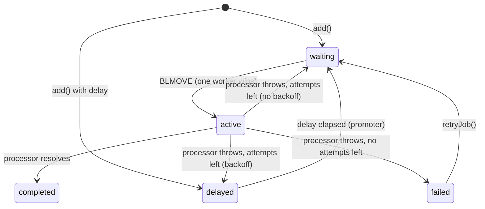

# TaskForge

> A Redis-backed background job queue built from scratch in TypeScript, with retries, exponential backoff, delayed jobs, concurrency, graceful shutdown, and a live dashboard.


<!-- Add a screenshot or GIF of the dashboard here:  -->

Libraries like BullMQ and Sidekiq power background work in most production apps: sending emails, generating reports, processing uploads. TaskForge re-implements the core of such a queue to show **how they work under the hood**: atomic state transitions with Lua, blocking pops, retry scheduling, and safe concurrency across many workers.

## Why use a queue? (live demo)

The dashboard includes a **Queue vs no queue** page (`/compare`) that runs the same signup flow two ways. A user signs up and the app sends a welcome email through a provider that is slow (1.5–3s) and unreliable (fails 40% of the time). Both sides call the exact same `sendWelcomeEmail()` function:

| | ❌ Without a queue | ✅ With a queue |
|---|---|---|
| The signup request… | sends the email itself | only calls `queue.add()` |
| User waits | 1.5–3s per signup | ~10–70ms |
| Provider fails | user sees "Something went wrong", email lost | worker retries with backoff, user never notices |
| Measured, 5 signups at once | waits of 1.6–2.9s, 1 of 5 got an error | all 5 answered in ~0.07s; 5 of 5 emails delivered, 3 provider failures retried |

For each queued signup, the page shows a live timeline: *queued → worker sending (attempt 1) → attempt 1 failed, retrying… → delivered after 2 attempts*.

## Features

- ⚛️ **Atomic state transitions:** every move between states is a Redis Lua script, so a job is never lost or in two states at once
- 👷 **Concurrency:** each worker runs N jobs in parallel; run as many worker processes as you like
- 🎯 **Exactly-one delivery to workers:** `BLMOVE` hands each job to a single worker, even with many competing
- 🔁 **Retries with backoff:** fixed or exponential (`delay · 2^(attempt-1)`), with error message and stack trace kept per job
- ⏰ **Delayed jobs:** run a job after N milliseconds
- 📈 **Progress reporting** from inside a running job
- 🧹 **Automatic cleanup:** keep only the last N completed/failed jobs
- 🛑 **Graceful shutdown:** on SIGINT/SIGTERM, workers stop taking jobs and finish in-flight ones
- 📊 **Dashboard:** live counts, job lists per state, job details (data, result, error stack), retry and remove

## Usage

```ts
import { Queue, Worker } from "@taskforge/core";

// Producer: e.g. inside an API route
const queue = new Queue("emails");
await queue.add("welcome", { to: "asha@example.com" }, {
  attempts: 3,
  backoff: { type: "exponential", delay: 1000 }, // retry after 1s, then 2s
});

// Consumer: a separate long-running process
const worker = new Worker("emails", async (job) => {
  await sendEmail(job.data.to);
  await job.updateProgress(100);
  return { sent: true }; // stored as the job's return value
}, { concurrency: 10 });

worker.on("failed", (job, err, willRetry) => console.log(job.id, err.message, willRetry));
process.on("SIGTERM", () => worker.close()); // finish in-flight jobs, then exit
```

## How it works

### Job lifecycle



### Redis data model

All keys of a queue share the `{queue}` [hash tag](https://redis.io/docs/latest/operate/oss_and_stack/reference/cluster-spec/#hash-tags), so they live on one Redis Cluster slot and multi-key Lua scripts stay valid.

| Key | Type | Purpose |
|---|---|---|
| `tf:{q}:id` | string | `INCR` counter for job ids |
| `tf:{q}:job:<id>` | hash | name, data, options, state, attempts, timestamps, result, error |
| `tf:{q}:waiting` | list | jobs ready to run (`LPUSH` in, `BLMOVE` out from the right → FIFO) |
| `tf:{q}:active` | list | jobs currently being processed |
| `tf:{q}:delayed` | sorted set | scored by the timestamp the job becomes runnable |
| `tf:{q}:completed` / `failed` | sorted set | scored by finish time, trimmed to the last N |

### Key design decisions

- **Why Lua scripts?** A state change touches several keys (remove from `active`, add to `completed`, update the hash). Done as separate commands, a crash in between would leave a job in two states or none. Redis runs a Lua script atomically, so no other client ever sees a half-finished transition.
- **Why `BLMOVE`?** It atomically pops from `waiting` and pushes to `active`, so two workers can never take the same job, and it *blocks* instead of polling, so idle workers cost almost nothing. Since a blocking command occupies its connection, each concurrency slot gets its own connection.
- **Why a sorted set for delayed jobs?** Scoring by run-at time makes "everything due now" a single `ZRANGEBYSCORE -inf <now>`. Every worker runs the promoter, and because it's a Lua script, many workers can run it at once without promoting a job twice.
- **Why does `close()` wait up to 1 second?** Workers block for at most 1 second per `BLMOVE` so shutdown is quick, but a job that was already moved to `active` is always processed rather than dropped.

### Known limitations (planned for v0.2)

- **Crashed workers leave jobs stuck in `active`.** If a process dies mid-job (`kill -9`, out of memory, power loss), nothing moves its jobs back. v0.2 adds **job locks with a heartbeat**: a worker renews a short-TTL lock while processing, and a stalled-job checker re-queues jobs whose lock expired. That turns delivery into **at-least-once**, which is why processors should be idempotent.
- The dashboard polls every second; v0.2 pushes updates over **Server-Sent Events** from Redis pub/sub.

## Project structure

```
packages/core/          # The queue library
  src/scripts.ts        #   Lua scripts for every state transition
  src/queue.ts          #   Producer + inspection API (add, getJobs, retry, remove)
  src/worker.ts         #   Concurrent consumer with backoff and graceful shutdown
  src/keys.ts           #   Redis key layout
  src/*.test.ts         #   Integration tests against real Redis
packages/demo-jobs/     # Simulated workloads shared by the worker and the dashboard
apps/worker/            # Demo worker process
apps/dashboard/         # Next.js dashboard + API routes, incl. the /compare demo
docker-compose.yml      # Local Redis
```

## Getting started

Requires Node.js 22+ and Docker (or any Redis 6.2+).

```bash
git clone https://github.com/alokera/taskforge.git
cd taskforge
npm install
docker compose up -d          # start Redis on localhost:6379

npm run dev:dashboard         # terminal 1 → http://localhost:3000
npm run dev:worker            # terminal 2
```

Click **+ 10 demo jobs** in the dashboard and watch them flow through the states. Things to try:
- Start a second worker (`npm run dev:worker` in another terminal) and see jobs spread across both.
- Press **Ctrl+C** on a worker while jobs are active: it finishes them before exiting.
- Open a failed `sync-crm` job to see its stack trace, then hit **Retry**.
- Open **Queue vs no queue** and click "Sign up 5 at once" on both sides.

Configuration is via environment variables, all optional (see `.env.example`):

| Variable | Default | Used by |
|---|---|---|
| `REDIS_URL` | `redis://localhost:6379` | dashboard, worker, tests |
| `QUEUE_NAME` | `demo` | dashboard, worker |
| `WORKER_CONCURRENCY` | `5` | worker |

### Tests

```bash
npm test   # needs Redis running; uses its own key prefix and cleans up after itself
```

The integration tests cover FIFO ordering, retries and backoff timing, permanent failure and manual retry, delayed jobs, the concurrency limit, exactly-once delivery across competing workers, progress, history trimming, and graceful shutdown.

## Roadmap

- [x] **v0.1:** Queue, concurrent workers, retries with backoff, delayed jobs, graceful shutdown, dashboard
- [ ] **v0.2:** Stalled-job recovery (locks + heartbeat), live dashboard via SSE, job priorities
- [ ] **v0.3:** Rate limiting, repeatable / cron jobs, throughput metrics and charts

## License

MIT
